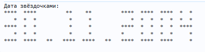

# Birthday stars

## Описание программы
Программа «Birthday stars» представляет собой веб-приложение для стилистического преобразования чисел. 
Пользователь вводит свою дату рождения (день, месяц, год), после чего программа:
- Определяет, на какой день недели приходилась эта дата.
- Проверяет, был ли этот год високосным.
- Вычисляет текущий возраст пользователя.
- Выводит дату рождения в консоль браузера в виде электронного табло, где каждая цифра нарисована звёздочками (`*`).

## Как запустить
Для запуска программы не требуется установка дополнительного программного обеспечения или серверов:
1. Скачайте все файлы проекта в одну папку.
2. Найдите файл `index.html` и откройте его двойным кликом (он откроется в вашем браузере по умолчанию).
3. Введите день, месяц и год рождения в появившиеся поля.
4. Нажмите кнопку **«Выполнить»**.

Результаты вычислений появятся на странице, а «звёздочная» дата — в консоли браузера. Чтобы её увидеть, нажмите `F12` (или `Ctrl+Shift+I`) и перейдите на вкладку **Console**.

## Пример вывода
Ниже представлен пример вывода даты `30.11.2004` в консоли браузера в виде звёздочек:




## Структура проекта
Проект состоит из следующих файлов, лежащих в одной корневой папке:

```text
Synergy_4s_1_birthday_stars/
├── index.html       # Основная HTML-страница с формой ввода и подключением скриптов
├── style.css        # Файл стилей для оформления интерфейса
├── birthday.js      # Файл с логикой вычислений (день недели, високосный год, возраст)
├── stars.js         # Файл с функцией отрисовки цифр звёздочками для консоли
├── readme.md        # Описание проекта (этот файл)
└── screenshot.png   # Скриншот с примером вывода в консоль
```

## Список реализованных функций
В проекте реализованы следующие функции (распределены по файлам `birthday.js` и `stars.js`):

1. **`getDayOfWeek(day, month, year)`** — определяет день недели для заданной даты.
2. **`isLeapYear(year)`** — проверяет, является ли год високосным.
3. **`getAge(day, month, year)`** — вычисляет возраст пользователя на текущий момент.
4. **`renderStarDate(day, month, year)`** — преобразует дату в строку, где цифры отрисованы символами `*` в формате электронного табло (высота 5 строк, ширина 4 символа).

## Технологии
- HTML
- CSS
- JavaScript
